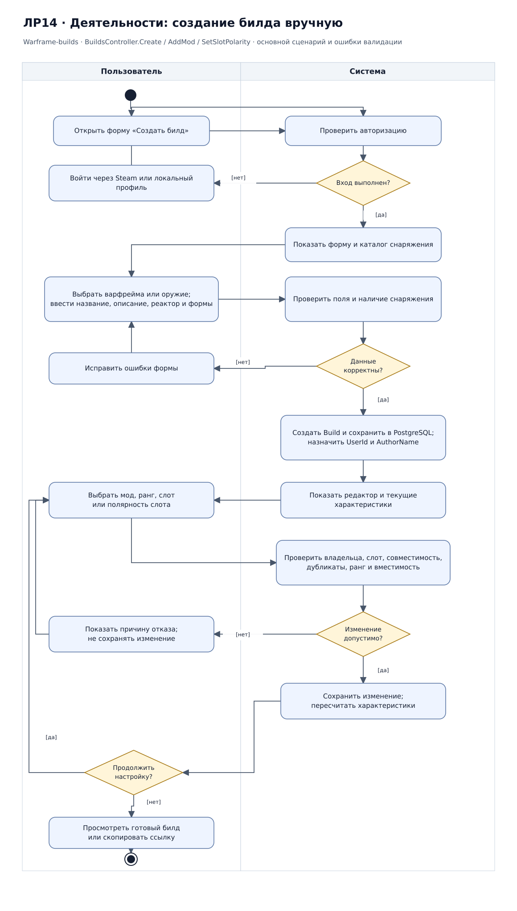
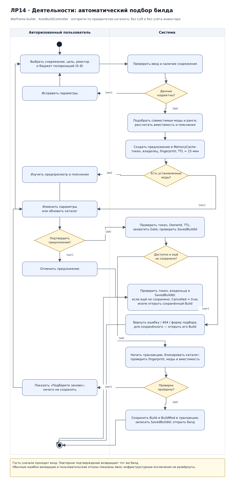
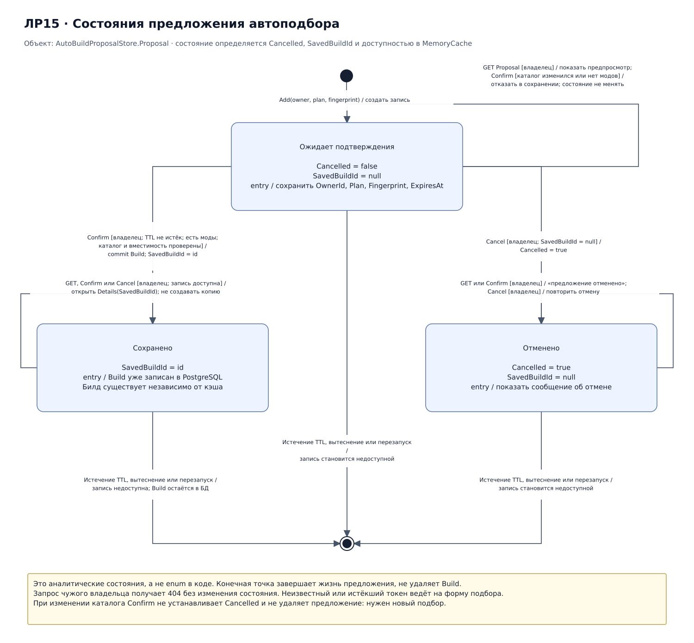
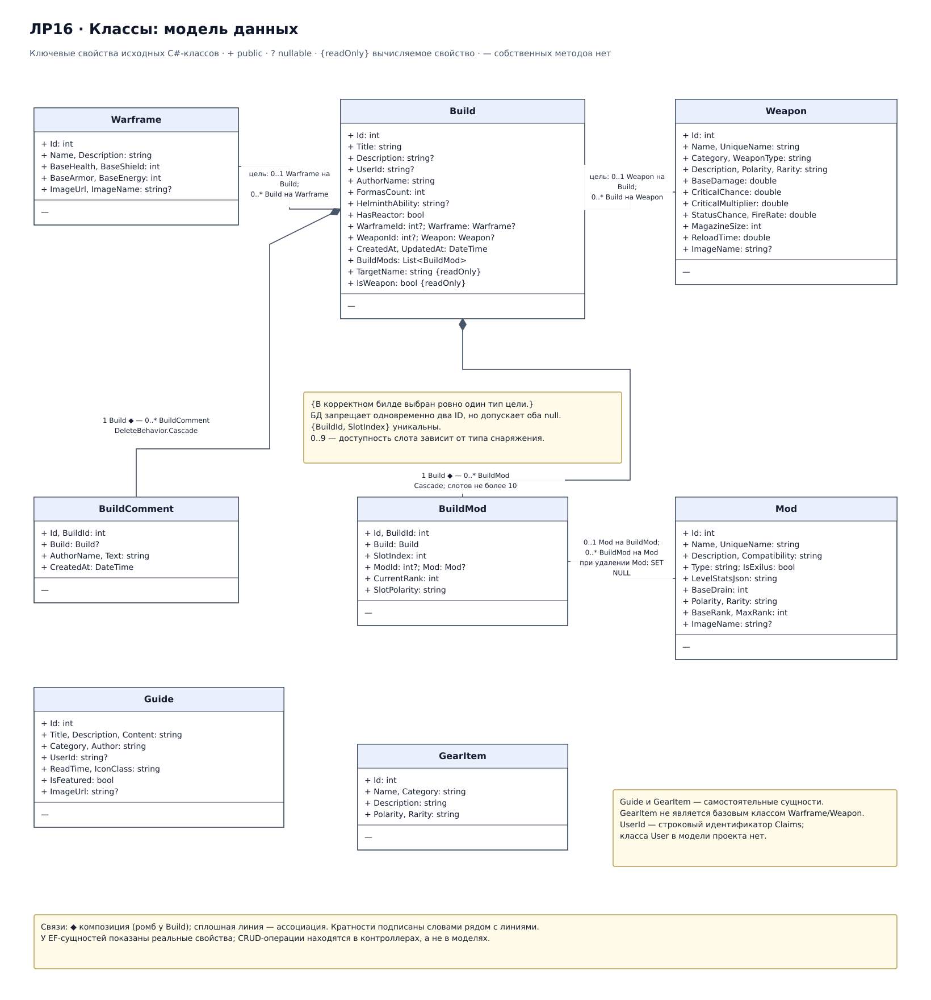
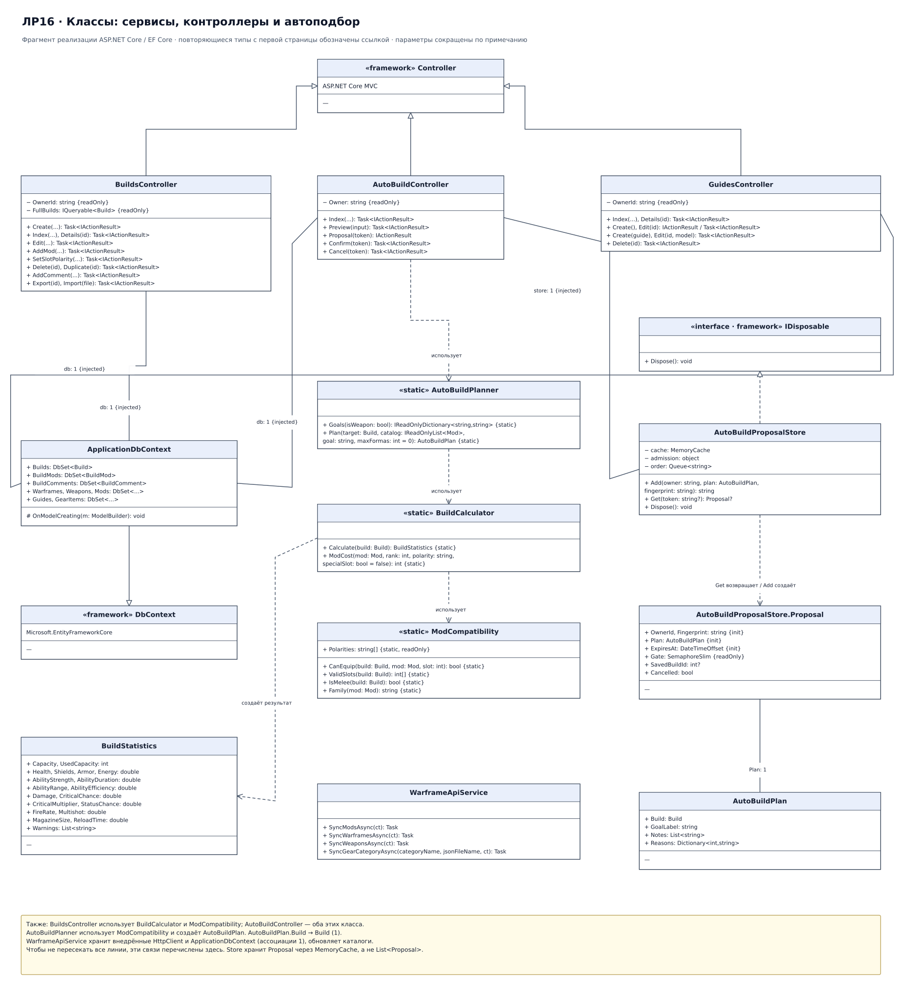

# UML-диаграммы warframe-builds

- [Диаграммы в PDF](Warframe-builds-UML.pdf) — пять страниц для просмотра.
- [Пояснение](EXPLANATION.md) — обоснование UML-связей, таблица переходов и ссылки на код.
- [Пояснение в Word](EXPLANATION.docx).

## Редактируемые диаграммы

1. [Деятельности — ручное создание и автоподбор](diagrams/01-activity.drawio).
2. [Состояний — предложение автоподбора](diagrams/02-state.drawio).
3. [Классов — модели, сервисы и контроллеры](diagrams/03-class.drawio).

Для скачивания отдельного файла откройте его и нажмите **Download raw file** (значок загрузки). Затем на [app.diagrams.net](https://app.diagrams.net) выберите «Файл → Открыть из → Устройство». В activity и class по две страницы, вкладки снизу.

Можно скачать весь репозиторий: зелёная кнопка **Code → Download ZIP**, затем открыть папку `docs/uml`.

## Просмотр отдельных страниц

Диаграммы отражают текущий код. Показаны пять обоснованных видов связей; отсутствие общей агрегации объяснено отдельно. Версия исходников: `05a2d2982023e106200c1de1993c47ef1088d925`.
